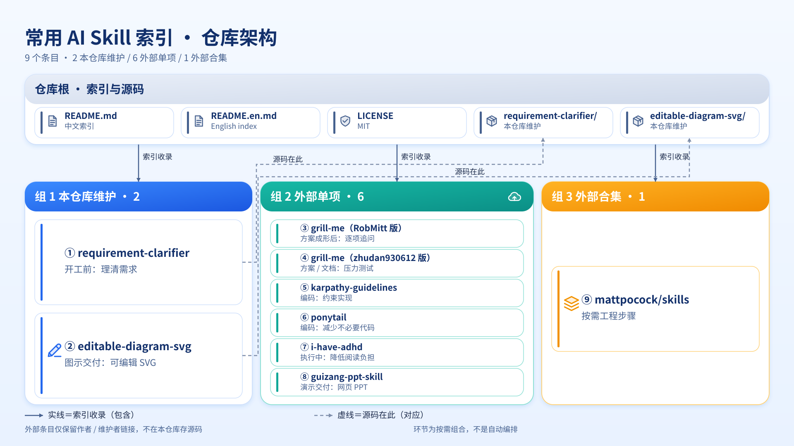
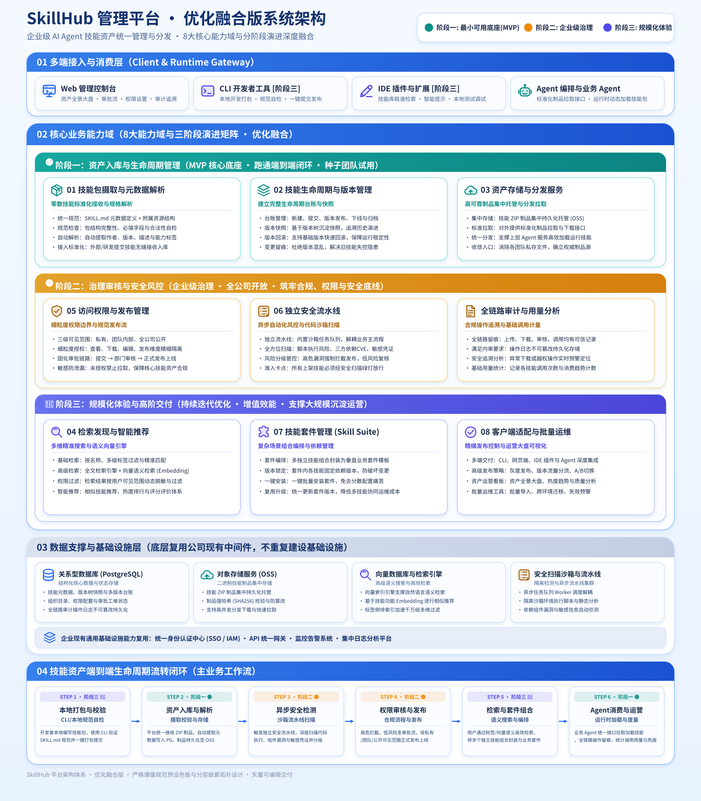

<div align="center">

[中文](./README.md) · **English**

# 🎯 Requirement Clarifier

#### From clear requirements to focused execution — save useful skills and install as needed

[](./LICENSE)
[](#-skills)
[](https://agentskills.io)


</div>

My index of useful AI skills, kept here for easy reference, download, and installation throughout my workflow.

Currently lists **9 entries: 8 individual skills + 1 skill collection**. The individual skills include 2 maintained here and 6 external skills; the two `grill-me` sources are listed separately, and duplicate links to the same repository count only once. `requirement-clarifier` and `editable-diagram-svg` are maintained in this repository with their full companion files. External skills and collections link to their authors or maintainers without copying source; follow their official documentation for installation and updates.

Skills are structured instruction sets that agents can load. Tools supporting the [Agent Skills](https://agentskills.io) standard can load compatible skills; support for extras such as plugins and hooks depends on the tool and its installation instructions.

## 🗺️ Repository at a glance



*This diagram is a real output sample of this repository's [editable-diagram-svg](./editable-diagram-svg/SKILL.md): it extracts the 9 entries and their sources from the README and organizes them as "repository root → three collection groups" in an editable SVG. Generation followed the full workflow — one outline confirmation, a frozen manifest, static validation, an actual render with visual inspection, then atomic publishing. Colors come from the preset allowlist, and text remains editable `text/tspan` rather than converted paths. [Fallback PNG preview](./image/repo-architecture.png).*

---

## 📋 Index

| Name | Workflow stage | One-liner | Source / Download |
|---|---|---|---|
| 🎯 [**requirement-clarifier**](#-requirement-clarifier) | Before starting: clarify requirements | Turns a vague idea into a clear four-part requirement (goal / decided / unsure / deliverables) | [Local skill](./requirement-clarifier/SKILL.md) · [Raw download](https://raw.githubusercontent.com/YunMeng6364/requirement-clarifier/main/requirement-clarifier/SKILL.md) |
| 🔥 [**grill-me (RobMitt)**](#grill-me-robmitt) | Once a plan takes shape: question decisions | Asks one multiple-choice question at a time, resolves decisions and dependencies, then summarizes agreement | [Author's repository](https://github.com/RobMitt/grill-me-skill) · [Raw download](https://raw.githubusercontent.com/RobMitt/grill-me-skill/main/SKILL.md) |
| 🔍 [**grill-me (zhudan930612)**](#grill-me-zhudan930612) | Plans / documents / content / designs: stress-test | Uses concise instructions to question decision branches and consult existing materials first | [Author's repository](https://github.com/zhudan930612/grill-me) · [Raw download](https://raw.githubusercontent.com/zhudan930612/grill-me/main/SKILL.md) |
| 🧰 [**mattpocock/skills (engineering collection)**](#mattpocock-skills) | From requirements alignment to implementation, testing, and review | Composable skills for interviews, decision documentation, test-driven development, and bug diagnosis | [Author's repository](https://github.com/mattpocock/skills) · [Skill directory](https://github.com/mattpocock/skills/tree/main/skills) · [Full repository ZIP](https://github.com/mattpocock/skills/archive/refs/heads/main.zip) |
| 🛠️ [**karpathy-guidelines**](#karpathy-guidelines) | Coding / fixes / refactoring: constrain implementation | Surfaces assumptions, favors simplicity and surgical changes, and defines verifiable goals | [Listed repository](https://github.com/multica-ai/andrej-karpathy-skills) · [Raw download](https://raw.githubusercontent.com/multica-ai/andrej-karpathy-skills/main/skills/karpathy-guidelines/SKILL.md) |
| 🐴 [**ponytail**](#ponytail) | Coding and review: avoid unnecessary code | Reuses existing code and platform features for the smallest complete change | [Author's repository](https://github.com/DietrichGebert/ponytail) · [Raw download](https://raw.githubusercontent.com/DietrichGebert/ponytail/main/skills/ponytail/SKILL.md) |
| 🧠 [**i-have-adhd**](#-i-have-adhd) | During execution: reduce reading friction | Makes the agent lead with actions, number steps, suppress tangents, and clarify what comes next | [Original repository](https://github.com/ayghri/i-have-adhd) · [Raw download](https://raw.githubusercontent.com/ayghri/i-have-adhd/main/skills/i-have-adhd/SKILL.md) |
| 🎨 [**guizang-ppt-skill**](#guizang-ppt-skill) | Presentation delivery: turn content into a talk | Creates magazine-style or Swiss-style single-file HTML slide decks with presenter mode and notes | [Author's repository](https://github.com/op7418/guizang-ppt-skill) · [Raw download](https://raw.githubusercontent.com/op7418/guizang-ppt-skill/main/SKILL.md) · [Full repository ZIP](https://github.com/op7418/guizang-ppt-skill/archive/refs/heads/main.zip) |
| 🖼️ [**editable-diagram-svg**](#editable-diagram-svg) | Diagram delivery: turn structure into an editable vector graphic | Extracts structure from text, docs, source, or an existing diagram and produces a palette-constrained editable SVG after one outline confirmation | [Local skill](./editable-diagram-svg/SKILL.md) · [Raw download](https://raw.githubusercontent.com/YunMeng6364/requirement-clarifier/main/editable-diagram-svg/SKILL.md) · [Full directory](https://github.com/YunMeng6364/requirement-clarifier/tree/main/editable-diagram-svg) |

### Putting them together

**Vague idea → clarify it with `requirement-clarifier` → optionally choose one `grill-me` to question the plan and expose assumptions → hand the requirements and confirmed decisions to an execution agent.** If responses during execution feel too long or hard to follow, enable `i-have-adhd` to adjust their presentation. This is a suggested sequence, not automatic orchestration; every step is optional.

For coding tasks, choose `karpathy-guidelines` to constrain assumptions, scope, and acceptance criteria, or `ponytail` to emphasize reuse and the smallest complete implementation. Their principles overlap; there is no need to enable both just to stack instructions.

For more specific engineering steps, choose from `mattpocock/skills`: `grill-with-docs` for alignment and decision records, `tdd` for test-driven implementation, or `diagnosing-bugs` for diagnosis. There is no need to activate the entire collection.

For a talk, report, or launch presentation, use `guizang-ppt-skill` to turn the confirmed content into a web slide deck. When the result is a structure — architecture, flow, hierarchy, or comparison — use `editable-diagram-svg` to produce an editable SVG; it presents a full outline for a single confirmation before drawing.

---

## 📦 Install

### requirement-clarifier

In an agent that supports Agent Skills (Claude Code, Codex…), just say:

```
Install this skill: https://github.com/YunMeng6364/requirement-clarifier/tree/main/requirement-clarifier
```

### editable-diagram-svg

This skill depends on `references/`, `assets/`, `scripts/`, `verification/`, and other companion files. Install the whole directory; a standalone `SKILL.md` cannot perform palette validation or real rendering. Copy this prompt into your agent:

```text
Install this skill: https://github.com/YunMeng6364/requirement-clarifier/tree/main/editable-diagram-svg
Keep the complete directory: SKILL.md, references/ (including palette.json), assets/ (including templates/ and icons.svg), scripts/, verification/, examples/, and agents/. Do not download only SKILL.md.
Rendering checks require Playwright with Chromium or another verified local renderer. If unavailable, mark the render check as not performed as described in SKILL.md; do not install dependencies or fabricate render results.
```

→ [SKILL.md](./editable-diagram-svg/SKILL.md) · [Full directory](https://github.com/YunMeng6364/requirement-clarifier/tree/main/editable-diagram-svg)

### grill-me (two sources; choose one)

**Both repositories declare the skill name `grill-me`, and the `mattpocock/skills` collection includes another skill with that name. Do not install them into the same directory: this can overwrite files or make activation ambiguous.** Choose RobMitt for one multiple-choice question at a time and a final decision summary; choose zhudan930612 for concise instructions covering plans, documents, content, and designs.

Copy the prompt for your chosen version into your agent:

```text
Install the RobMitt version of grill-me: https://github.com/RobMitt/grill-me-skill
Read README.md and SKILL.md first and install for my current tool. If a skill with the same name already exists, ask for confirmation instead of overwriting it.
```

```text
Install the zhudan930612 version of grill-me: https://github.com/zhudan930612/grill-me
Read README.md and SKILL.md first and install for my current tool. If a skill with the same name already exists, ask for confirmation instead of overwriting it.
```

→ [RobMitt installation notes](https://github.com/RobMitt/grill-me-skill#install) · [zhudan930612 usage notes](https://github.com/zhudan930612/grill-me#readme)

### mattpocock/skills (collection; choose what you need)

```text
Help me install useful engineering skills from https://github.com/mattpocock/skills.
Read README.md first, list installation options for my current tool and available skills, and wait for my selection. Do not install both the plugin and the skills.sh file version in the same agent.
Check for existing skill names, especially grill-me, instead of overwriting or duplicating them. Keep companion files and dependency skills for the selected skills rather than copying entry-point SKILL.md files alone.
Before first using the engineering skills, follow the upstream setup-matt-pocock-skills instructions. Confirm configuration before writing project rules or documents.
```

Upstream provides plugin installation and editable-file installation; **choose one per agent**. Before first using engineering skills, run `/setup-matt-pocock-skills` in the target project to confirm issue tracking, triage labels, and documentation locations.

→ [Official installation guide](https://github.com/mattpocock/skills#installation-30-second-setup) · [Skill directory](https://github.com/mattpocock/skills/tree/main/skills) · [Full repository ZIP](https://github.com/mattpocock/skills/archive/refs/heads/main.zip)

### karpathy-guidelines (andrej-karpathy-skills)

```text
Install karpathy-guidelines from this repository: https://github.com/multica-ai/andrej-karpathy-skills
Read README.md and skills/karpathy-guidelines/SKILL.md first. Use this repository's skill rather than silently switching to another source.
If installation requires editing an existing CLAUDE.md or other rules file, show the merge plan first and do not overwrite existing content.
```

The repository is named `andrej-karpathy-skills`, but the actual skill name is **`karpathy-guidelines`**. These are third-party guidelines inspired by Andrej Karpathy's observations, not his official skill. Some installation examples in the linked README still point to `forrestchang/andrej-karpathy-skills`; check the actual source when installing.

→ [Repository installation notes](https://github.com/multica-ai/andrej-karpathy-skills#install) · [Skill file](https://github.com/multica-ai/andrej-karpathy-skills/blob/main/skills/karpathy-guidelines/SKILL.md) · [CLAUDE.md rules version](https://github.com/multica-ai/andrej-karpathy-skills/blob/main/CLAUDE.md)

### ponytail

```text
Install ponytail from https://github.com/DietrichGebert/ponytail.
Read README.md and INSTALL.md first and choose the skill, rules file, or full plugin installation for my current tool.
Do not overwrite existing rules. Explain any plugin hooks or additional components and ask for confirmation before enabling them.
```

→ [Official installation guide](https://github.com/DietrichGebert/ponytail/blob/main/INSTALL.md) · [Skill file](https://github.com/DietrichGebert/ponytail/blob/main/skills/ponytail/SKILL.md) · [Compact AGENTS.md rules](https://github.com/DietrichGebert/ponytail/blob/main/AGENTS.md)

### i-have-adhd

Copy this prompt into your agent:

```text
Install i-have-adhd from https://github.com/ayghri/i-have-adhd.
Read the repository's AGENTS.md and INSTALL.md first, then choose the installation method for the tool I am using.
```

→ [Official installation guide](https://github.com/ayghri/i-have-adhd/blob/main/INSTALL.md) (installation, updates, and removal for supported tools)

### guizang-ppt-skill

Copy this prompt into your agent:

```text
Install guizang-ppt-skill from https://github.com/op7418/guizang-ppt-skill.
Read README.md first and install the complete skill for my current tool, keeping SKILL.md and its companion assets/, references/, scripts/, and other files. Do not download only SKILL.md.
```

→ [Official installation notes](https://github.com/op7418/guizang-ppt-skill#readme) · [Full repository ZIP](https://github.com/op7418/guizang-ppt-skill/archive/refs/heads/main.zip)

**Only need the instructions?** Open “Raw download” in the index and save the page as `SKILL.md`. If your agent does not support skills, you can try using the text as project rules or pasting it into a conversation. This provides instructions only, not companion templates, scripts, palettes, plugin hooks, or automatic loading; equivalent behavior is not guaranteed. Both `editable-diagram-svg` and `guizang-ppt-skill` depend on repository resources and should be installed in full. A downloaded ZIP also needs to be placed in your tool's skill directory according to its installation requirements.

---

## ✨ Skills

<a id="-skills"></a>

### 🎯 requirement-clarifier

> *"You don't have trouble describing your requirement — you just haven't been asked the right questions."*

**It solves exactly one thing: turning a vague ask into a clear requirement.**

You have an idea, but you haven't fully thought it through yourself, let alone know how to hand it to an AI or a developer. This skill asks you a bounded, prioritized, converging set of questions, then turns it into a four-part requirement document: **goal / already decided / still unsure / deliverables**. What you get is a clean block of text you can copy and hand straight to an AI or a developer.

**Why "four-part"**

The biggest failure mode of human–AI collaboration is disagreement on what "done" means. Four parts fix that: **goal** answers "what do we achieve, and how do we know it's done", **decided** pins down known facts and constraints, **unsure** explicitly lists every open question by priority, and **deliverables** fixes the output format and acceptance criteria. It doesn't write code for you — it gets the conversation before the code right.

**How to trigger** (Chinese)

```
帮我梳理需求
我有个想法但说不清
帮我分析一下我要做什么
帮我理清思路
帮我把需求整理出来
```

**Good for**

- You have an idea but it comes out messy and incomplete
- You want to align on the requirement before building, to avoid rework
- You need a structured requirement doc to hand to an AI / developer

**Not good for**

- The requirement is already complete and you just want the AI to build
- Simple fact questions, casual chat, looking things up

→ [SKILL.md](./requirement-clarifier/SKILL.md)

---

<a id="grill-me-robmitt"></a>

### 🔥 grill-me (RobMitt)

> *One question at a time, until the plan's decisions and dependencies are clear.*

**A structured interview about a plan or design.** Its instructions explicitly require one question at a time through `AskUserQuestion`, with 2–4 concrete options, waiting for the answer before continuing. Questions answerable from code or files should be investigated first. The interview ends with a concise summary of decisions.

**How to trigger**

```text
grill me on this plan
Stress-test this design, one question at a time
```

**Good for**

- Checking decisions and dependencies in an existing plan or design
- Multiple-choice interaction without a long list of simultaneous questions
- Getting a decision summary when the interview finishes

**Not good for**

- Direct execution without an extended interview
- Expecting identical popup interaction without adaptation in a tool that lacks `AskUserQuestion`

→ [Author: RobMitt](https://github.com/RobMitt) · [Source repository](https://github.com/RobMitt/grill-me-skill) · [SKILL.md](https://github.com/RobMitt/grill-me-skill/blob/main/SKILL.md)

---

<a id="grill-me-zhudan930612"></a>

### 🔍 grill-me (zhudan930612)

> *Question each decision branch, consult the materials, and close gaps in understanding.*

**Concise instructions for stress-testing a plan, document, content piece, or design.** It walks decision branches and resolves dependencies until reaching shared understanding. Questions answerable from the codebase, documents, or provided materials should be investigated first.

Unlike the RobMitt version, this `SKILL.md` does not explicitly require a multiple-choice tool, one question at a time, or a final decision summary. Choose based on your preferred interaction rather than installing both.

**How to trigger**

```text
grill me on this PRD
Stress-test this plan
Challenge this design
```

**Good for**

- Finding blind spots and unresolved decisions in plans, PRDs, drafts, or designs
- Having the agent consult existing materials before asking repeat questions
- Starting an interview with concise instructions rather than a prescribed interaction format

**Not good for**

- Polishing, summarization, or direct execution without questioning
- Expecting a fixed-format review report without additional instructions

→ [Author: zhudan930612](https://github.com/zhudan930612) · [Source repository](https://github.com/zhudan930612/grill-me) · [SKILL.md](https://github.com/zhudan930612/grill-me/blob/main/SKILL.md)

---

<a id="mattpocock-skills"></a>

### 🧰 mattpocock/skills (engineering collection)

> *Small, composable engineering skills: choose what the task needs rather than adopting an entire process at once.*

**Matt Pocock's skill collection, not a single skill with one entry point.** It covers requirements interviews, domain vocabulary and decision records, implementation, testing, diagnosis, and code review. This index counts it as one collection entry; consult the author's directory for individual skills.

**Useful entry points**

| Skill | When to use it | Source |
|---|---|---|
| `grill-me` | Interview about a plan or idea until reaching shared understanding | [SKILL.md](https://github.com/mattpocock/skills/blob/main/skills/productivity/grill-me/SKILL.md) |
| `grill-with-docs` | Build a glossary and record architectural decisions (ADRs) during an interview | [SKILL.md](https://github.com/mattpocock/skills/blob/main/skills/engineering/grill-with-docs/SKILL.md) |
| `tdd` | Start with failing tests, implement incrementally, and verify behavior through public interfaces | [SKILL.md](https://github.com/mattpocock/skills/blob/main/skills/engineering/tdd/SKILL.md) |
| `diagnosing-bugs` | Build a reproducible feedback loop before investigating the cause | [SKILL.md](https://github.com/mattpocock/skills/blob/main/skills/engineering/diagnosing-bugs/SKILL.md) |
| `setup-matt-pocock-skills` | Configure issue tracking and documentation conventions before first using engineering skills | [SKILL.md](https://github.com/mattpocock/skills/blob/main/skills/engineering/setup-matt-pocock-skills/SKILL.md) |

**How to trigger**

After installation and project setup, invoke the relevant skill in a tool supporting the corresponding commands, for example:

```text
/grill-with-docs
/tdd
/diagnosing-bugs
```

These are separate task entry points, not a script to run in order. The collection's `grill-me` calls `grilling`, while `grill-with-docs` calls both `grilling` and `domain-modeling`. Entry-point files alone omit dependencies; use a supported upstream installation method and preserve the required skills and companion resources.

**Good for**

- Composing requirements alignment, decision records, implementation, and testing as needed
- Preserving project context through shared vocabulary, ADRs, and verification loops
- Setting up project conventions before selecting engineering skills

**Not good for**

- Installing the entire repository as one `SKILL.md`
- Installing everything without checking names and dependencies, or duplicating plugin and file installations in one agent
- Expecting identical commands, interactions, and automatic updates in every tool

→ [Author: Matt Pocock](https://github.com/mattpocock) · [Source repository](https://github.com/mattpocock/skills) · [Skill directory](https://github.com/mattpocock/skills/tree/main/skills) · [Installation guide](https://github.com/mattpocock/skills#installation-30-second-setup)

---

<a id="karpathy-guidelines"></a>

### 🛠️ karpathy-guidelines

> *Surface assumptions, change only what is needed, and define completion through verifiable goals.*

**Four principles for agent coding behavior: think before coding, simplicity first, surgical changes, and goal-driven execution.** They aim to reduce unchecked assumptions, unnecessary abstractions, and unrelated edits, replacing “fix it” with concrete success criteria.

This entry links to `karpathy-guidelines` in `multica-ai/andrej-karpathy-skills`. It is a third-party interpretation of Andrej Karpathy's observations, not automated verification or a quality guarantee.

**How to trigger**

```text
Use karpathy-guidelines to fix this bug; first state assumptions and success criteria
Refactor this code with simple, scoped changes and verify behavior before and after
```

**Good for**

- Clarifying assumptions, ambiguity, and tradeoffs before implementation
- Limiting the scope of fixes and refactoring in an existing project
- Defining completion through tests or concrete checks

**Not good for**

- Expecting built-in test tooling or a replacement for actual verification
- Framework-specific expertise or one-click repairs

→ [Listed source: multica-ai](https://github.com/multica-ai) · [Source repository](https://github.com/multica-ai/andrej-karpathy-skills) · [SKILL.md](https://github.com/multica-ai/andrej-karpathy-skills/blob/main/skills/karpathy-guidelines/SKILL.md)

---

<a id="ponytail"></a>

### 🐴 ponytail

> *The best code is code you establish you do not need to write; everything the task does need still gets done.*

**It prioritizes existing code, standard libraries, platform features, and installed dependencies before new code.** The aim is the smallest complete implementation, not code golf. Necessary validation, error handling, security, and accessibility must not be sacrificed for brevity.

The core skill has `lite`, `full` (default), and `ultra` levels. The full plugin also provides commands such as `/ponytail-review` and `/ponytail-audit` for reviewing changes and auditing repositories. Availability depends on installation and tool support; downloading the core skill alone does not install the full plugin.

**How to trigger**

```text
ponytail, implement the simplest complete solution and reuse existing code first
Fix this using ponytail principles, without unnecessary abstractions
```

Tools supporting the corresponding commands can switch levels with `/ponytail lite`, `/ponytail full`, or `/ponytail ultra`. The core instructions keep the mode active for the current conversation until you say `stop ponytail` or `normal mode`.

**Good for**

- Reducing overengineering, duplicate implementations, and unnecessary dependencies
- Having the agent read code and trace callers before making a complete, minimal change
- Simplifying implementations while preserving necessary checks

**Not good for**

- Sacrificing correctness, tests, or security boundaries to reduce code
- Expecting guaranteed percentage reductions in code, time, or cost for every project

→ [Author: DietrichGebert](https://github.com/DietrichGebert) · [Source repository](https://github.com/DietrichGebert/ponytail) · [SKILL.md](https://github.com/DietrichGebert/ponytail/blob/main/skills/ponytail/SKILL.md) · [Installation guide](https://github.com/DietrichGebert/ponytail/blob/main/INSTALL.md)

---

### 🧠 i-have-adhd

> *Action first, explanation second — make the next step easy to find.*

**It reduces the effort of reading and acting on agent responses. It is not a requirement clarifier or a medical diagnostic or treatment tool.** No ADHD diagnosis is needed to use it for your reading preferences.

It asks the agent to lead with actions, number multi-step tasks, suppress tangents, restate the current state across turns, and make the next step concrete. Useful when responses feel too long, you lose track of context, or you want to focus on one task at a time.

**How to trigger**

After installation, type `/i-have-adhd` in Claude Code or `$i-have-adhd` in Codex. The upstream instructions keep it active for the current conversation until you say `stop adhd mode` or `normal mode`. For other tools, follow the official installation guide.

**Good for**

- Seeing an actionable step before a lengthy introduction
- Working through numbered steps while keeping progress visible
- Reducing tangents so responses are easier to read and act on

**Not good for**

- Long-form output, open-ended discussion, or responses without brevity constraints
- Task automation, calendar management, or medical use

→ [Author: ayghri](https://github.com/ayghri) · [Source repository](https://github.com/ayghri/i-have-adhd) · [SKILL.md](https://github.com/ayghri/i-have-adhd/blob/main/skills/i-have-adhd/SKILL.md) · [Installation guide](https://github.com/ayghri/i-have-adhd/blob/main/INSTALL.md)

---

<a id="guizang-ppt-skill"></a>

### 🎨 guizang-ppt-skill

> *Turn articles, plans, and ideas into slide decks you can present in a browser.*

**It generates single-file HTML presentations, not natively editable PowerPoint `.pptx` files.** It includes two visual systems, editorial magazine/e-ink and Swiss International Style, with horizontal navigation, WebGL backgrounds, presenter view, synchronized audience screens, speaker notes, and timed rehearsal. It also provides workflows for slide images and social covers.

**How to trigger**

```text
Turn this Markdown into a magazine-style presentation
Create a Swiss-style web slide deck of about 7 slides from this plan
Add speaker notes and planned timings to each slide
```

**Good for**

- Turning articles, plans, or product introductions into talks, reports, and launch presentations
- Magazine-style storytelling or Swiss-style factual and methodological presentations
- Browser playback, speaker notes, dual-screen presenting, and rehearsal

**Not good for**

- Required native `.pptx` delivery or collaborative online editing
- Large tables, dense data, or information-heavy training materials
- Expecting template-dependent features from a standalone `SKILL.md` download

→ [Author: Guizang (op7418)](https://github.com/op7418) · [Source repository](https://github.com/op7418/guizang-ppt-skill) · [SKILL.md](https://github.com/op7418/guizang-ppt-skill/blob/main/SKILL.md) · [Installation notes](https://github.com/op7418/guizang-ppt-skill#readme)

---

<a id="editable-diagram-svg"></a>

### 🖼️ editable-diagram-svg

> *Get the structure right first, then produce a vector file where every stroke stays editable.*

**It turns structure found in text, documents, source code, configuration, data, or an existing diagram into an editable SVG.** The visual system is fixed: a light blue gradient background, saturated group header bars with white text, white rounded cards, and inline vector icons. Text stays real `text/tspan` elements rather than converted paths, so wording and colors can be changed directly in the source.

**One confirmation before drawing**

Before generating, it presents a complete outline — scope, every visible element, relationships and direction, one primary topology (nested / left-to-right / hub-and-spoke / timeline / grid / tree / funnel / comparison), detail level, exact color choices, line styles and legend, split-diagram suggestions, and fallbacks. You confirm once and the outline is frozen; later changes to content, color, or diagram count require an incremental confirmation rather than silent edits.

Colors come only from the allowlisted `palette.json`, never inferred from business roles. After generation it runs structural and palette validation, then **actually renders and visually inspects** the result at target size — checking line breaks, occlusion, arrow endpoints, and white-text legibility. A generated PNG or a passing keyword check does not substitute for visual inspection.

**How to trigger** (Chinese)

```text
把这份架构说明画成可编辑 SVG
根据这段代码整理一张模块关系图
把这份流程图改成浅蓝渐变风格
```

**Good for**

- Architecture, flow, hierarchy, network, timeline, and comparison diagrams
- Delivering an editable vector source that will need wording or color changes later
- Consistent color, line style, and legend rules verified by a real render

**Not good for**

- Photos, raster illustrations, logos, or anything needing bitmap texture
- A quick throwaway sketch without an outline confirmation
- Environments with no verified renderer where full render sign-off is required

**Output sample**

<p align="center">
  <a href="./image/skillhub-架构图.svg">
    
  </a>
</p>

*A more complex sample: "SkillHub Management Platform — Optimized Integrated System Architecture". The source is 1680×1920; only the width is set here, so the height scales proportionally to 480px (about 28% of the original). [Open the full-size SVG](./image/skillhub-架构图.svg). It shows how the skill handles multiple groups, nested layers, and dense connections: palette-consistent group headers, white rounded cards, arrowed connectors and a legend, with all text still editable `text/tspan`.*

→ [SKILL.md](./editable-diagram-svg/SKILL.md) · [Full directory](https://github.com/YunMeng6364/requirement-clarifier/tree/main/editable-diagram-svg) · [Color spec](./editable-diagram-svg/references/color-spec.md) · [Verification guide](./editable-diagram-svg/references/verification.md)

---

## 🗂️ Maintaining this index

For each new skill, add its **workflow stage, one-line purpose, source, and raw download link** to the index, then follow the existing format for its description and official installation link. Skills maintained here need their full companion directories; install and update external skills from upstream rather than maintaining copies here.

A README is enough for now. Consider an installation manifest and scripts only when bulk installation, version pinning, or automatic cross-device synchronization becomes necessary.

---

## 🌟 About

If this helps you, a ⭐ is appreciated. Questions or suggestions welcome in Issues / Discussions.

---

<div align="center">

[MIT License](./LICENSE) · Free to use, modify, and redistribute

Made by [@YunMeng6364](https://github.com/YunMeng6364)

</div>
