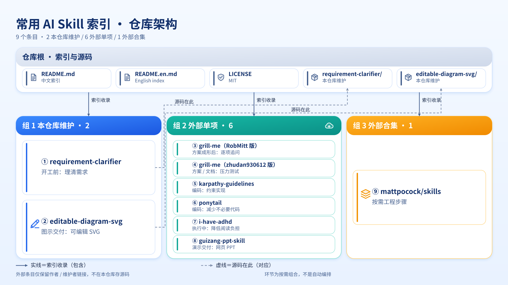
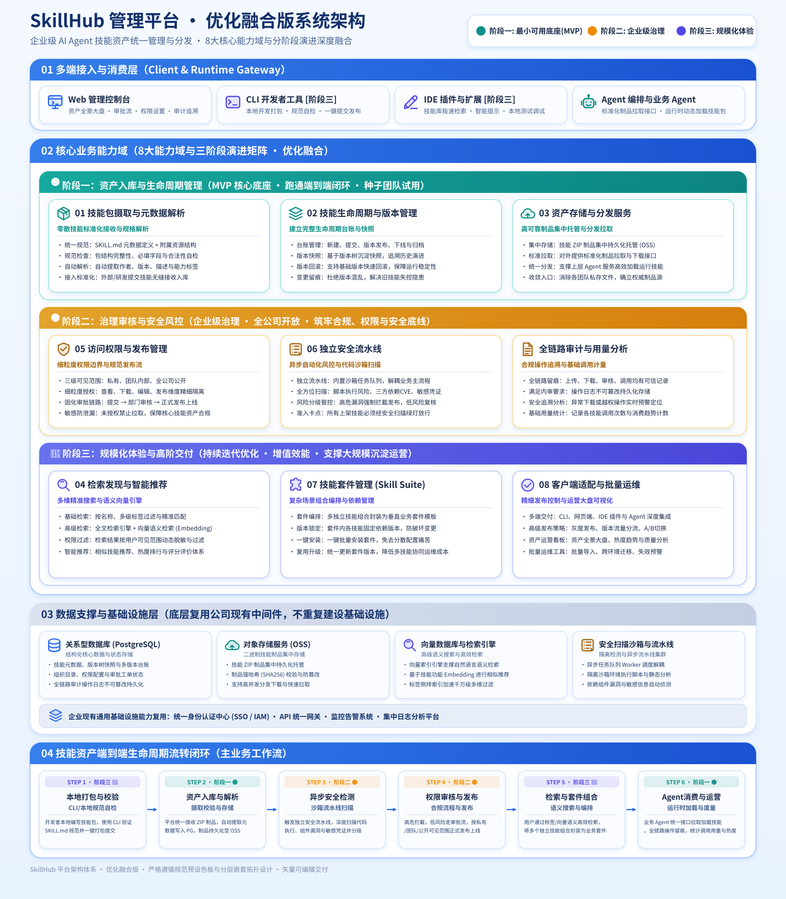

<div align="center">

**中文** · [English](./README.en.md)

# 🎯 Requirement Clarifier

#### 从需求澄清到专注执行，记录常用 Skill，按需安装

[](./LICENSE)
[](#-skills)
[](https://agentskills.io)


</div>

这是我的常用 AI Skill 索引，用来记录、下载和安装工作流里用得上的 Skill，也分享给有需要的人。

目前收录 **9 个条目：8 个单项 Skill + 1 个 Skill 合集**。单项中有 2 个由本仓库维护、6 个来自外部；两个 `grill-me` 来源分别列出，同一仓库的重复链接不重复收录。本仓库维护 `requirement-clarifier` 和 `editable-diagram-svg` 两个 Skill 的完整文件；外部 Skill 和合集保留作者或维护者链接，不复制源码，安装与更新以其官方文档为准。

Skill 是 Agent 可以加载的结构化指令集。支持 [Agent Skills](https://agentskills.io) 标准的工具可以加载兼容的 Skill；插件、钩子等额外能力是否可用，需查看对应工具的安装说明。

## 🗺️ 仓库一览



*本图由本仓库的 [editable-diagram-svg](./editable-diagram-svg/SKILL.md) 生成，也是这个 Skill 的实际产出示例：从 README 提取 9 个条目与来源关系，按「仓库根 → 三组收录」组织成可编辑 SVG。生成遵循其完整流程——一次提纲确认、冻结清单、静态校验、实际渲染目视后发布；配色取自预设白名单，文字仍是 `text/tspan`，改字改色可直接在源码里完成。[备用的 PNG 展示副本](./image/repo-architecture.png)。*

---

## 📋 目录

| 名字 | 使用环节 | 一句话 | 来源 / 下载 |
|---|---|---|---|
| 🎯 [**requirement-clarifier（需求澄清器）**](#-requirement-clarifier需求澄清器) | 开工前：理清需求 | 把模糊的诉求，聊成「目标 / 已确定 / 拿不准 / 产出要求」四段式清晰需求 | [本仓库](./requirement-clarifier/SKILL.md) · [原文下载](https://raw.githubusercontent.com/YunMeng6364/requirement-clarifier/main/requirement-clarifier/SKILL.md) |
| 🔥 [**grill-me（RobMitt 版）**](#grill-me-robmitt) | 方案成形后：逐项追问 | 一次一个选择题，逐个厘清设计决策与依赖，最后汇总共识 | [作者仓库](https://github.com/RobMitt/grill-me-skill) · [原文下载](https://raw.githubusercontent.com/RobMitt/grill-me-skill/main/SKILL.md) |
| 🔍 [**grill-me（zhudan930612 版）**](#grill-me-zhudan930612) | 方案 / 文档 / 内容 / 设计：压力测试 | 用精简指令持续追问，优先查阅已有材料，逐个解决决策分支 | [作者仓库](https://github.com/zhudan930612/grill-me) · [原文下载](https://raw.githubusercontent.com/zhudan930612/grill-me/main/SKILL.md) |
| 🧰 [**mattpocock/skills（工程 Skill 合集）**](#mattpocock-skills) | 从需求对齐到实现、测试和审查 | 按需组合访谈、决策文档、测试驱动开发和故障诊断等 Skill | [作者仓库](https://github.com/mattpocock/skills) · [Skill 目录](https://github.com/mattpocock/skills/tree/main/skills) · [完整仓库 ZIP](https://github.com/mattpocock/skills/archive/refs/heads/main.zip) |
| 🛠️ [**karpathy-guidelines（编码准则）**](#karpathy-guidelines) | 编码 / 修复 / 重构：约束实现 | 显式说明假设、保持简单、精准修改，以可验证的目标推进 | [收录仓库](https://github.com/multica-ai/andrej-karpathy-skills) · [原文下载](https://raw.githubusercontent.com/multica-ai/andrej-karpathy-skills/main/skills/karpathy-guidelines/SKILL.md) |
| 🐴 [**ponytail（极简实现）**](#ponytail) | 编码与审查：减少不必要代码 | 优先复用现有代码和平台能力，用最小但完整的改动解决任务 | [作者仓库](https://github.com/DietrichGebert/ponytail) · [原文下载](https://raw.githubusercontent.com/DietrichGebert/ponytail/main/skills/ponytail/SKILL.md) |
| 🧠 [**i-have-adhd（专注输出）**](#-i-have-adhd专注输出) | 执行中：降低阅读负担 | 让 Agent 先给行动、分步表达、减少岔题，明确下一步 | [原作者仓库](https://github.com/ayghri/i-have-adhd) · [原文下载](https://raw.githubusercontent.com/ayghri/i-have-adhd/main/skills/i-have-adhd/SKILL.md) |
| 🎨 [**guizang-ppt-skill（归藏网页 PPT）**](#guizang-ppt-skill) | 演示交付：把内容做成分享 | 生成杂志风 / 瑞士风的单文件 HTML 演示文稿，支持演讲者模式与备注 | [作者仓库](https://github.com/op7418/guizang-ppt-skill) · [原文下载](https://raw.githubusercontent.com/op7418/guizang-ppt-skill/main/SKILL.md) · [完整仓库 ZIP](https://github.com/op7418/guizang-ppt-skill/archive/refs/heads/main.zip) |
| 🖼️ [**editable-diagram-svg（可编辑 SVG 图）**](#editable-diagram-svg) | 图示交付：把结构画成可编辑矢量图 | 从文字、文档、源码或已有图提取结构，一次提纲确认后生成预设色板的可编辑 SVG | [本仓库](./editable-diagram-svg/SKILL.md) · [原文下载](https://raw.githubusercontent.com/YunMeng6364/requirement-clarifier/main/editable-diagram-svg/SKILL.md) · [完整目录](https://github.com/YunMeng6364/requirement-clarifier/tree/main/editable-diagram-svg) |

### 怎么串成工作流

**想法说不清 → 用 `requirement-clarifier` 梳理需求 → 按需选一个 `grill-me` 追问方案、暴露假设 → 把需求和已确认的决策交给执行 Agent。** 如果执行时觉得回复太长、重点难找，再启用 `i-have-adhd` 调整输出方式。这只是按需组合的使用顺序，不是自动编排，也不要求全部启用。

编码任务可选用 `karpathy-guidelines` 约束假设、修改范围和验收，或用 `ponytail` 强调复用与最小完整实现。两者理念有重叠，不需要为了叠加而全部启用。

需要更细的工程步骤时，可以从 `mattpocock/skills` 合集中按需选用 `grill-with-docs` 对齐需求并记录决策、`tdd` 测试驱动实现、`diagnosing-bugs` 诊断故障，不必整套启用。

需要把结果用于分享、汇报或发布时，可以用 `guizang-ppt-skill` 把确认后的内容做成网页 PPT；需要把架构、流程或层级关系画成可编辑矢量图时，用 `editable-diagram-svg` 生成 SVG——它在出图前会先给一份完整提纲，让你一次确认再生成。

---

## 📦 安装方式

### requirement-clarifier

在 Claude Code、Codex 等支持 Agent Skills 的工具里，直接说：

```
帮我安装这个 skill：https://github.com/YunMeng6364/requirement-clarifier/tree/main/requirement-clarifier
```

### editable-diagram-svg

这个 Skill 依赖 `references/`、`assets/`、`scripts/`、`verification/` 等配套文件，必须安装完整目录；只下载 `SKILL.md` 无法完成取色、校验和实际渲染。把下面这段话复制给你的 Agent：

```text
帮我安装这个 skill：https://github.com/YunMeng6364/requirement-clarifier/tree/main/editable-diagram-svg
请保留完整目录结构，包含 SKILL.md、references/（含 palette.json）、assets/（含 templates/ 与 icons.svg）、scripts/、verification/、examples/ 和 agents/，不要只下载 SKILL.md。
渲染检查需要本机已具备 Playwright 与 Chromium，或其他已核实的本地渲染器；缺少时按 SKILL.md 说明标注「未完成渲染验收」，不要擅自安装依赖或编造渲染结果。
```

→ [SKILL.md](./editable-diagram-svg/SKILL.md) · [完整目录](https://github.com/YunMeng6364/requirement-clarifier/tree/main/editable-diagram-svg)

### grill-me（两个来源，建议二选一）

**这两个仓库的 Skill 名称都是 `grill-me`，`mattpocock/skills` 合集中也有同名 Skill。不要直接安装到同一个目录，以免覆盖或触发混淆。** 想要“一次一个选择题 + 决策总结”，选 RobMitt 版；想用更精简的指令审视方案、文档、内容或设计，选 zhudan930612 版。

复制所选版本的安装提示词给 Agent：

```text
帮我安装 RobMitt 版 grill-me：https://github.com/RobMitt/grill-me-skill
请先阅读 README.md 和 SKILL.md，按当前工具安装；如已有同名 Skill，先提示我确认，不要覆盖。
```

```text
帮我安装 zhudan930612 版 grill-me：https://github.com/zhudan930612/grill-me
请先阅读 README.md 和 SKILL.md，按当前工具安装；如已有同名 Skill，先提示我确认，不要覆盖。
```

→ [RobMitt 版说明](https://github.com/RobMitt/grill-me-skill#install) · [zhudan930612 版说明](https://github.com/zhudan930612/grill-me#readme)

### mattpocock/skills（合集，按需选择）

```text
帮我从 https://github.com/mattpocock/skills 安装常用工程 Skill。
请先阅读 README.md，列出适合当前工具的安装方式和可选 Skill，让我确认后再安装；同一工具不要同时安装插件版和 skills.sh 文件版。
检查已有同名 Skill，尤其是 grill-me，不要直接覆盖或重复安装。按需保留所选 Skill 的配套文件和依赖 Skill，不要只复制入口 SKILL.md。
首次使用工程类 Skill 前，按上游说明运行 setup-matt-pocock-skills；写入项目规则或文档前先确认配置。
```

上游同时提供插件安装和可编辑文件安装方式，**同一 Agent 选一种即可**。工程类 Skill 首次使用前，应在目标项目中运行 `/setup-matt-pocock-skills`，确认任务跟踪方式、分诊标签和文档存放位置。

→ [官方安装说明](https://github.com/mattpocock/skills#installation-30-second-setup) · [Skill 目录](https://github.com/mattpocock/skills/tree/main/skills) · [完整仓库 ZIP](https://github.com/mattpocock/skills/archive/refs/heads/main.zip)

### karpathy-guidelines（andrej-karpathy-skills）

```text
帮我安装这个仓库里的 karpathy-guidelines：https://github.com/multica-ai/andrej-karpathy-skills
请先阅读 README.md 和 skills/karpathy-guidelines/SKILL.md，使用这个仓库的 Skill，不要自动切换其他仓库来源。
如需写入已有 CLAUDE.md 或其他规则文件，先展示合并方案，不要覆盖原有内容。
```

仓库名是 `andrej-karpathy-skills`，实际 Skill 名称是 **`karpathy-guidelines`**。这是受 Andrej Karpathy 观点启发的第三方编码准则，不是他的官方 Skill；所链接仓库的 README 部分安装示例仍指向 `forrestchang/andrej-karpathy-skills`，安装时需要核对实际来源。

→ [仓库安装说明](https://github.com/multica-ai/andrej-karpathy-skills#install) · [Skill 文件](https://github.com/multica-ai/andrej-karpathy-skills/blob/main/skills/karpathy-guidelines/SKILL.md) · [CLAUDE.md 规则版](https://github.com/multica-ai/andrej-karpathy-skills/blob/main/CLAUDE.md)

### ponytail

```text
帮我安装 ponytail：https://github.com/DietrichGebert/ponytail
请先阅读 README.md 和 INSTALL.md，按当前工具选择 Skill、规则文件或完整插件的安装方式。
不要覆盖已有规则；涉及插件钩子或额外组件时，先说明需要启用的内容并让我确认。
```

→ [官方安装说明](https://github.com/DietrichGebert/ponytail/blob/main/INSTALL.md) · [Skill 文件](https://github.com/DietrichGebert/ponytail/blob/main/skills/ponytail/SKILL.md) · [AGENTS.md 精简规则版](https://github.com/DietrichGebert/ponytail/blob/main/AGENTS.md)

### i-have-adhd

把下面这段话复制给你的 Agent：

```text
帮我安装 i-have-adhd：https://github.com/ayghri/i-have-adhd
请先阅读仓库的 AGENTS.md 和 INSTALL.md，按我当前使用的工具选择安装方式。
```

→ [官方安装说明](https://github.com/ayghri/i-have-adhd/blob/main/INSTALL.md)（含不同工具的安装、更新与卸载方式）

### guizang-ppt-skill

把下面这段话复制给你的 Agent：

```text
帮我安装 guizang-ppt-skill：https://github.com/op7418/guizang-ppt-skill
请先阅读 README.md，按当前工具安装完整 Skill，保留 SKILL.md、assets/、references/、scripts/ 等配套文件，不要只下载 SKILL.md。
```

→ [官方安装说明](https://github.com/op7418/guizang-ppt-skill#readme) · [完整仓库 ZIP](https://github.com/op7418/guizang-ppt-skill/archive/refs/heads/main.zip)

**只想下载指令？** 点击目录里的「原文下载」，将页面另存为 `SKILL.md`。不支持 Skill 的 Agent 也可以尝试把全文作为项目规则或贴进对话使用，但这只提供指令文本，不包含配套模板、脚本、色板、插件钩子或自动加载等能力，不能保证效果一致。`editable-diagram-svg` 和 `guizang-ppt-skill` 都依赖仓库中的配套资源，应完整安装；ZIP 下载后也需要按当前工具的要求放入 Skill 目录。

---

## ✨ Skills

<a id="-skills"></a>

### 🎯 requirement-clarifier（需求澄清器）

> *"你不是说不清需求，你只是还没被问到点子上。"*

**它只解决一件事：帮你把模糊的诉求聊清楚。**

你有过一个想法，但自己都还没想明白，更不知道怎么让 AI 或开发去实现——这个 Skill 会通过**有边界、有优先级、可收敛**的多轮提问，把它梳理成一份「目标 / 已确定 / 拿不准 / 产出要求」四段式需求文档。你最后拿到的是一段可以直接复制、拿去继续和 AI 对话、或交给开发的干净文本。

**为什么是「四段式」**

人和 AI 协作最大的坑，是双方对「要做什么」的理解不一致。四段式把话说清楚：**目标**回答「最终要达成什么、怎样算完成」，**已确定**写死已知的事实和约束，**拿不准**显式列出所有不确定点并按优先级排，**产出要求**约定交付物、格式和验收标准。它不帮你写代码，它帮你把「写代码之前的那些话」说对。

**怎么触发**

```
帮我梳理需求
我有个想法但说不清
帮我分析一下我要做什么
帮我理清思路
帮我把需求整理出来
```

**适合**

- 脑子里有想法，但一开口就乱、说不完整
- 想开工前先把需求对齐，避免做了一半返工
- 需要一份能直接复制给 AI / 开发的结构化需求文档

**不适合**

- 需求已经很完整，只想让 AI 直接开干
- 单纯问事实、闲聊、查资料

→ [SKILL.md](./requirement-clarifier/SKILL.md)

---

<a id="grill-me-robmitt"></a>

### 🔥 grill-me（RobMitt 版）

> *用一次一个问题的方式，把方案中的决策和依赖问清楚。*

**它侧重对计划或设计做结构化访谈。** 指令明确要求每次通过 `AskUserQuestion` 工具提一个问题、提供 2–4 个具体选项，等待回答后继续；能从代码或文件中查到的内容先自行查阅，最后给出简洁的决策总结。

**怎么触发**

```text
grill me on this plan
请对这个设计做压力测试，一次问我一个问题
```

**适合**

- 已有计划或设计，希望逐项确认决策与依赖
- 喜欢选择题交互，不想同时面对一大串问题
- 希望访谈结束后得到一份决策总结

**不适合**

- 只想直接执行，不希望进入持续追问
- 当前工具不提供 `AskUserQuestion`，却希望不作适配就获得相同的弹窗交互

→ [作者：RobMitt](https://github.com/RobMitt) · [源码仓库](https://github.com/RobMitt/grill-me-skill) · [SKILL.md](https://github.com/RobMitt/grill-me-skill/blob/main/SKILL.md)

---

<a id="grill-me-zhudan930612"></a>

### 🔍 grill-me（zhudan930612 版）

> *沿着决策分支持续追问，先查材料，再补齐理解。*

**它用更精简的指令，对方案、文档、内容或设计做压力测试。** 核心是逐个审视决策分支、解决决策之间的依赖，直到形成共同理解；能从代码库、文档或已提供材料中找到答案的问题，优先自行查阅。

与 RobMitt 版相比，这份 `SKILL.md` 没有明确规定必须使用选择题工具、每次只问一个问题或最后输出决策总结。可以按自己偏好的交互方式选择，不必同时安装。

**怎么触发**

```text
拷打这个方案
挑战这个设计
拷打这篇文档
grill me on this PRD
```

**适合**

- 已有方案、PRD、文稿或设计，想发现盲点和未解决的决策
- 希望 Agent 先查已有材料，减少重复询问
- 想用简短指令启动追问，不强制限定交互格式

**不适合**

- 只要润色、摘要或直接执行，不需要质询
- 希望不补充要求就保证得到固定格式的评审报告

→ [作者：zhudan930612](https://github.com/zhudan930612) · [源码仓库](https://github.com/zhudan930612/grill-me) · [SKILL.md](https://github.com/zhudan930612/grill-me/blob/main/SKILL.md)

---

<a id="mattpocock-skills"></a>

### 🧰 mattpocock/skills（工程 Skill 合集）

> *把工程实践拆成小而可组合的 Skill，按当前任务选择，不必把整个流程一次搬进来。*

**这是 Matt Pocock 的 Skill 合集，不是一个统一入口的单项 Skill。** 覆盖需求访谈、领域术语与决策文档、实现、测试、故障诊断和代码审查等环节。这里按一个合集条目收录，具体 Skill 以作者目录为准。

**常用入口**

| Skill | 什么时候用 | 源文件 |
|---|---|---|
| `grill-me` | 对计划或想法持续追问，形成共同理解 | [SKILL.md](https://github.com/mattpocock/skills/blob/main/skills/productivity/grill-me/SKILL.md) |
| `grill-with-docs` | 在访谈过程中建立术语表并记录架构决策（ADR） | [SKILL.md](https://github.com/mattpocock/skills/blob/main/skills/engineering/grill-with-docs/SKILL.md) |
| `tdd` | 从失败测试开始，小步实现，通过公共接口验证行为 | [SKILL.md](https://github.com/mattpocock/skills/blob/main/skills/engineering/tdd/SKILL.md) |
| `diagnosing-bugs` | 先构建能复现故障的反馈回路，再逐步定位原因 | [SKILL.md](https://github.com/mattpocock/skills/blob/main/skills/engineering/diagnosing-bugs/SKILL.md) |
| `setup-matt-pocock-skills` | 首次使用工程类 Skill 前，配置项目的任务跟踪和文档约定 | [SKILL.md](https://github.com/mattpocock/skills/blob/main/skills/engineering/setup-matt-pocock-skills/SKILL.md) |

**怎么触发**

安装及项目初始化后，在支持相应命令的工具中按任务调用，例如：

```text
/grill-with-docs
/tdd
/diagnosing-bugs
```

这些是不同任务的入口，不是要求依次运行的脚本。合集中的 `grill-me` 会调用 `grilling`，`grill-with-docs` 会调用 `grilling` 和 `domain-modeling`；只下载入口文件会缺少依赖，应通过上游支持的方式保留所需 Skill 和配套资源。

**适合**

- 想按需组合需求对齐、决策记录、实现与测试的工程流程
- 希望用共享术语、ADR 和验证回路保留项目上下文
- 愿意先做项目初始化，再选用所需 Skill

**不适合**

- 把整个仓库当作单个 `SKILL.md` 安装
- 未检查同名 Skill 和依赖就全部安装，或在同一 Agent 重复安装插件版与文件版
- 期待所有工具都支持相同的命令、交互和自动更新方式

→ [作者：Matt Pocock](https://github.com/mattpocock) · [源码仓库](https://github.com/mattpocock/skills) · [Skill 目录](https://github.com/mattpocock/skills/tree/main/skills) · [安装说明](https://github.com/mattpocock/skills#installation-30-second-setup)

---

<a id="karpathy-guidelines"></a>

### 🛠️ karpathy-guidelines（编码准则）

> *先说明假设，只改必要的地方，用可验证的目标判断是否完成。*

**它用四条准则约束 Agent 的编码行为：先思考、简单优先、精准修改、目标驱动。** 用于减少未经确认的假设、过度抽象和顺手改动无关代码，把“修好它”转成能验证的成功标准。

本条目指向 `multica-ai/andrej-karpathy-skills` 中的 `karpathy-guidelines`。它是第三方根据 Andrej Karpathy 的观察整理的指令，不代表自动验证或质量保证。

**怎么触发**

```text
请按 karpathy-guidelines 修复这个 bug，先明确假设和成功标准
重构这段代码，保持简单，只改与目标有关的部分，并验证前后行为
```

**适合**

- 编码前想明确假设、歧义和方案取舍
- 修复或重构现有项目，希望限制改动范围
- 希望用测试或具体检查来定义“完成”

**不适合**

- 期待它自动提供测试工具或替代实际验证
- 把它当作某个框架的专业知识包或一键修复器

→ [收录来源：multica-ai](https://github.com/multica-ai) · [源码仓库](https://github.com/multica-ai/andrej-karpathy-skills) · [SKILL.md](https://github.com/multica-ai/andrej-karpathy-skills/blob/main/skills/karpathy-guidelines/SKILL.md)

---

<a id="ponytail"></a>

### 🐴 ponytail（极简实现）

> *最好的代码，是确认不需要写的代码；该做的部分仍要完整完成。*

**它让 Agent 优先复用代码库、标准库、平台能力和已有依赖，再考虑写新代码。** 目标是最小但完整的实现，而不是代码越短越好；不能以精简为由省掉必要的验证、错误处理、安全性或可访问性。

核心 Skill 提供 `lite`、`full`（默认）、`ultra` 三档。完整插件还提供 `/ponytail-review` 和 `/ponytail-audit` 等命令，分别用于改动审查和仓库审查；这些额外能力是否可用取决于安装方式及工具支持，单独下载核心 Skill 不等于装好完整插件。

**怎么触发**

```text
ponytail，用最简单但完整的方案实现这个功能，优先复用已有代码
请按 ponytail 的原则修复这个问题，不做额外抽象
```

支持相应命令的工具中可用 `/ponytail lite`、`/ponytail full`、`/ponytail ultra` 切换档位。按核心指令，启用后在当前会话持续生效，输入 `stop ponytail` 或 `normal mode` 关闭。

**适合**

- 想减少过度工程、重复实现和不必要的新依赖
- 希望 Agent 先读代码、追踪调用，再做最小完整改动
- 想在保留必要检查的前提下简化实现

**不适合**

- 为追求少写代码而牺牲正确性、测试或安全边界
- 期待对任何项目都保证固定比例的代码量、耗时或费用下降

→ [作者：DietrichGebert](https://github.com/DietrichGebert) · [源码仓库](https://github.com/DietrichGebert/ponytail) · [SKILL.md](https://github.com/DietrichGebert/ponytail/blob/main/skills/ponytail/SKILL.md) · [安装说明](https://github.com/DietrichGebert/ponytail/blob/main/INSTALL.md)

---

### 🧠 i-have-adhd（专注输出）

> *先给行动，再给解释；让下一步一眼就能找到。*

**它解决的是 Agent 回复的阅读和行动负担，不是需求澄清，也不是医疗诊断或治疗工具。** 不需要有 ADHD 诊断，也可以按自己的阅读习惯使用。

它会要求 Agent 把行动放在前面、多步任务编号、减少岔题、在多轮对话中重述当前状态，并给出明确的下一步。适合回复太长看不下去、执行过程中容易丢失上下文，或希望一次只聚焦当前任务的场景。

**怎么触发**

安装后，Claude Code 中输入 `/i-have-adhd`；Codex 中输入 `$i-have-adhd`。按上游指令，启用后在当前会话持续生效，输入 `stop adhd mode` 或 `normal mode` 关闭。其他工具的启用方式以官方安装说明为准。

**适合**

- 想先看到能做的动作，而不是大段铺垫
- 需要分步推进任务，并随时知道当前进展
- 希望减少岔题，让回复更容易读完和执行

**不适合**

- 需要完整长文、发散讨论或不受精简规则限制的输出
- 把它当作任务自动化、日程管理或医疗工具

→ [原作者：ayghri](https://github.com/ayghri) · [源码仓库](https://github.com/ayghri/i-have-adhd) · [SKILL.md](https://github.com/ayghri/i-have-adhd/blob/main/skills/i-have-adhd/SKILL.md) · [安装说明](https://github.com/ayghri/i-have-adhd/blob/main/INSTALL.md)

---

<a id="guizang-ppt-skill"></a>

### 🎨 guizang-ppt-skill（归藏网页 PPT）

> *把文章、方案和观点，做成可以在浏览器里翻页演讲的网页 PPT。*

**它生成的是单文件 HTML 演示文稿，不是可直接编辑的 PowerPoint `.pptx` 文件。** 内置“电子杂志 × 电子墨水”和“瑞士国际主义”两套视觉风格，支持横向翻页、WebGL 背景、演讲者视图、观众屏同步、讲稿备注和计时排练，也提供配图与多平台封面的制作流程。

**怎么触发**

```text
帮我把这份 Markdown 做成杂志风演讲 PPT
基于这份方案做一份 7 页左右的瑞士风网页 PPT
给这份 PPT 补齐演讲备注和每页计划时长
```

**适合**

- 把文章、方案或产品介绍做成分享、汇报、发布会演示
- 想用杂志风讲故事，或用瑞士风表达事实与方法论
- 需要浏览器播放、讲稿备注、双屏演讲和排练

**不适合**

- 必须交付原生 `.pptx` 或需要多人在线协作编辑
- 以大段表格、密集数据或高信息密度培训课件为主
- 只下载 `SKILL.md`，却希望完整使用依赖模板和参考文件的能力

→ [作者：歸藏（op7418）](https://github.com/op7418) · [源码仓库](https://github.com/op7418/guizang-ppt-skill) · [SKILL.md](https://github.com/op7418/guizang-ppt-skill/blob/main/SKILL.md) · [安装说明](https://github.com/op7418/guizang-ppt-skill#readme)

---

<a id="editable-diagram-svg"></a>

### 🖼️ editable-diagram-svg（可编辑 SVG 图）

> *结构先讲清楚，再落成一笔一划都能改的矢量图。*

**它把文字、文档、源码、配置、数据或已有图里的结构，生成成一张可编辑的 SVG。** 固定视觉风格：浅蓝渐变背景、饱和色主分组标题栏配白字、白色圆角卡片、内嵌矢量图标。文字是真正的 `text/tspan`，不是转成路径的图片，改字改色都能直接在源码里做。

**出图前只确认一次**

生成前它会先给一份完整提纲——图名与边界、要画什么、关系与方向、主拓扑（nested / left-to-right / hub-and-spoke / timeline / grid / tree / funnel / comparison）、细节分级、精确取色、线型图例、拆图建议与回退方案——你一次确认后冻结再生成。确认后要改内容、颜色或图数，需要增量确认，不会悄悄改动。

颜色只能取自预设白名单 `palette.json`，不按业务职责自动定色；生成后还要跑结构与色板校验，并用已核实的渲染工具**实际渲染目视**（中文换行、遮挡、箭头端点、白字可读性等）。PNG 生成成功或关键词校验通过都不算替代目视检查。

**怎么触发**

```text
把这份架构说明画成可编辑 SVG
根据这段代码整理一张模块关系图
把这份流程图改成浅蓝渐变风格
给这张图补一张「总览 + 机制」的分层详图
```

**适合**

- 架构、流程、层级、网络、时间线与对比图
- 需要交付可继续编辑的矢量源文件，后续要改文字或配色
- 希望配色、线型、图例有统一规范，并经过实际渲染检查

**不适合**

- 照片、栅格插画、品牌标志或需要位图质感的内容
- 只想快速要一张示意图，不想先确认提纲
- 当前环境没有任何可用渲染器，却要求完成渲染验收

**产出示例**

<p align="center">
  <a href="./image/skillhub-架构图.svg">
    
  </a>
</p>

*一张更复杂的产出示例：「SkillHub 管理平台 · 优化融合版系统架构」。原图 1680×1920，这里只指定宽度、高度按原比例自适应缩到 480px（约原尺寸的 28%），[点击查看完整尺寸](./image/skillhub-架构图.svg)。可以看到它处理多分组、多层嵌套与密集连线时的样子：统一色板的分组标题栏、白色圆角卡片、带箭头的连线与图例，文字仍是可编辑的 `text/tspan`。*

→ [SKILL.md](./editable-diagram-svg/SKILL.md) · [完整目录](https://github.com/YunMeng6364/requirement-clarifier/tree/main/editable-diagram-svg) · [允许色板](./editable-diagram-svg/references/color-spec.md) · [校验说明](./editable-diagram-svg/references/verification.md)

---

## 🗂️ 后续怎么维护

新增常用 Skill 时，在目录里补上**使用环节、一句话用途、来源和原文下载链接**，再按现有格式补充介绍及官方安装入口即可。本仓库自建的 Skill 需要保留完整配套目录；外部 Skill 从上游安装和更新，不在这里维护副本。

当前用 README 就够了；等确实需要批量安装、固定版本或跨设备自动同步时，再考虑增加安装清单和脚本。

---

## 🌟 关于

开源出来如果对你有帮助，给个 ⭐ 就行。有问题或建议，欢迎在 Issues / Discussions 里说一声。

---

<div align="center">

[MIT License](./LICENSE) · 自由使用 / 修改 / 再分发

Made by [@YunMeng6364](https://github.com/YunMeng6364)

</div>
